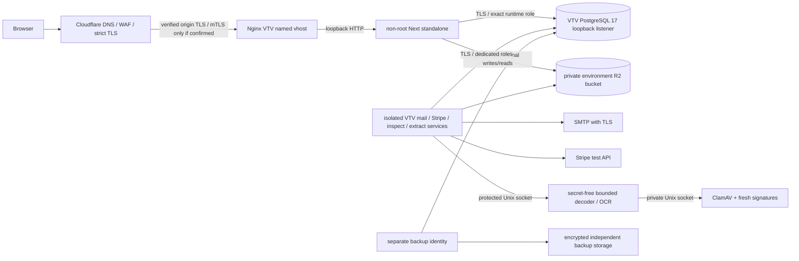

# Architecture, sizing and private inputs

## Topology and trust boundaries

Production target: **ServerVerse VPS**, with a dedicated PostgreSQL 17 cluster/database on the same host, and **vetthevat.com**. Staging remains a separate environment. The actual host OS, architecture, capacity, open ports, PostgreSQL state, TLS topology and Cloudflare configuration are unknown until the authorized read-only host audit. Ubuntu 24.04 / AMD64 / Node **22.23.4 Linux x64** are still package assumptions, not verified ServerVerse facts.



The production PostgreSQL instance must be VTV-dedicated and listen only on `127.0.0.1` at an unused, explicitly approved port. Do not reuse or reconfigure an existing shared PostgreSQL cluster before the read-only audit. Web and worker processes run under distinct non-login service users on the same VPS; inspect/extract communicate with the bounded processor and ClamAV over protected Unix sockets. Web has no access to those sockets. Database, service and storage paths must be VTV-only. Keep R2 as the existing private-originals integration; do not make originals public or put them in the release tree. Never copy the development database into production.

## Exact initial resource allocation

No VPS capacity has been measured. Do not treat other websites' allocated memory or disk as available. Capacity is a hard pre-deployment gate: ClamAV can use up to 3 GiB, bounded processing up to 2 GiB, plus PostgreSQL, Next.js, OS, signatures, backups and existing applications. Verify actual free headroom under representative load before choosing service limits; never silently disable scanning or OCR to fit.

| Component | Staging | Production |
| --- | --- | --- |
| VPS capacity reserved for VTV | Not measured | Not measured; must leave headroom for database, app, ClamAV and OCR without consuming unrelated services' resources |
| PostgreSQL | Separate staging environment | Dedicated PostgreSQL 17 cluster and database; loopback-only listener, verified TLS, selected free port |
| Workers | Per-environment isolated service identities | Same VPS, isolated service accounts and Unix sockets; resource caps require measured host capacity |
| Linux CI build runner | 4 vCPU, 8 GiB RAM, 20 GiB workspace; no provider credentials | Same architecture/glibc/Node patch as runtime |
| Private original storage | Existing private R2 integration, separately configured | Existing private R2 integration; account/bucket/prefix-lock acceptance and independent file recovery remain required |

Processing concurrency is one native document at a time, with <=10 MiB original, <=20 pages, <=20 million pixels per page, <=100 MB decoded RGBA budget and command/deadline limits. ClamAV unit is capped at 3 GiB; processing at 2 GiB; each job process at 768 MiB; OS, signatures, caches and concurrent mail/Stripe need headroom. Increase throughput only after measurement, not by removing bounds. R2 capacity depends on document volume and retention; indefinite lock means storage can grow indefinitely and requires a separately approved retention/legal policy.

Database pool ceilings per environment: web auth 3 + business 3 + webhook ingress up to 2 per active request process + short readiness 1; mail 3, Stripe 1, inspect 1, extract 1, optional contact 2. Limit web instances and webhook concurrency; leave administrative/backup/failover headroom. No arbitrary unlimited PM2/Node cluster processes.

## On-host structure

```text
/opt/vetthevat/node/                       # reviewed Node 22 runtime, root-owned
/srv/vetthevat/{staging,production}/
  releases/<version>/
    release.json / checksums.json
    app/server.js / app/node_modules / app/.next / app/public
    app/workers/{main,processing}.cjs
    deploy/
  current -> releases/<version>
  previous -> releases/<previous-version>
/etc/vetthevat/<environment>/              # root-owned, 0751 for CA traversal
  web.env                                 # root:root 0600, systemd reads before dropping UID
  workers/{mail,stripe,inspect,extract}.env # root:root 0600
  processing.env                          # non-secret settings only, root:root 0600
  postgres-ca.pem                         # non-secret public CA, root:root 0644
  postgres-server.key                     # dedicated PG key, postgres-only 0600
  acceptance.json                         # root:root 0600, false until evidence is reviewed
  tls/                                    # root:root 0700; origin.key 0600
/var/lib/vetthevat-<env>-<job>/             # per-user 0700 state and heartbeat
/run/vetthevat-<env>/processing.sock        # 0660, processor group only
/run/vetthevat-clamav-<env>/clamd.sock      # 0660, scanner group only
```

Each role gets a system account with `/usr/sbin/nologin`, no sudo, no owner membership and no shared writable release tree. Web, workers and the dedicated PostgreSQL instance use separate service identities. The existing MongoDB, PM2, PostgreSQL clusters, Nginx sites and other service users are excluded. There is no global Nginx config replacement or automatic package/service upgrade.

## Private inputs required per environment

| Input | Scope / handling |
| --- | --- |
| Hostnames, VPS architecture and available resources | Approved new virtual-host names; later read-only host inventory after separate connection authorization |
| PostgreSQL 17 cluster, approved unused loopback port, CA, dedicated database and installation IDs | VTV-only instance, loopback-only TLS, exact database/port approval; no URL SSL overrides |
| Migration credential | Offline/DBA-only `vtv_migrator`; owner SET ROLE only, never installed in web or worker env |
| Auth/business/document/provider/contact credentials | Exact restricted role per URL; no owner/admin/default credentials; auth worker currently shares auth-runtime privilege until reviewed narrower-role migration |
| R2 account/bucket/object key/secret and policy-read API token | Separate buckets and tokens; no public domains or r2.dev; audited lock on `companies/`; no default AWS credentials |
| Stripe test keys, four Price IDs, pinned API version and signing secret | Test only; Basic £9, Starter £15, Growth £25 monthly GBP, Basic ORS £5; no live payment enablement |
| SMTP hostname/port/TLS/user/password and verified sender | Nodemailer only; STARTTLS on 587 or implicit TLS on 465; certificate verification always on; customer mail disabled until approved |
| Turnstile site/secret and dedicated contact/lead inputs | Public site key only may reach browser; backend remains disabled until managed/contact worker acceptance |
| Independent CSRF/outbox/health/worker secrets | Environment-specific; 32-byte hex for auth cryptographic keys; never printed or placed in NEXT_PUBLIC variables |
| Origin certificate/key, origin-pull client CA and Cloudflare policy | Full (strict), hostname-valid origin certificate, mTLS and reviewed source restrictions; WAF/cache rules scoped to new hostname |
| Backup operator / PITR / encrypted offsite destination / age recipient | Backup identity isolated from runtime; decryption private key only on recovery system; separate fresh restore target |
| Monitoring destination and operational owners | No payload/secret logs; defined queue-age/error/backup/failure alerts |

Secret values belong in private files or a secret manager, never chat, Git, build contexts, release archives or CI logs.
