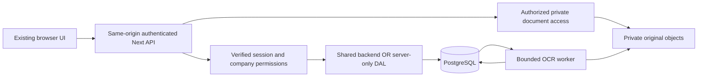

# Secure backend integration plan

Proposal only. Nothing here has been implemented, provisioned, connected or migrated.
Current-state evidence references E1–E15 in stage-4-architecture-discovery.md.
All structured production application data must use **PostgreSQL**. Original binary
documents should use private object storage, with ownership/checksums/versions in
PostgreSQL. This does not introduce a second business database.

## Conditional architecture choice

| Approach | When viable | Advantages / risks / decisions |
| --- | --- | --- |
| Existing shared API + Next server facade | Owner supplies an actual maintainable, authenticated, PostgreSQL-backed backend and contracts | Preferred if verified: reuse identities/company data and Android integration. Avoid a second write path or database. Existing API is currently UNKNOWN despite docs' assertion (E6/E7). Contract/session/role/migration gaps may exceed deadline. |
| Next Node server API + server-only data-access layer + PostgreSQL | No suitable shared backend is confirmed, and owner approves owning one | Reuses Next App Router and current UI/domain code. Keep one API/DAL, approved PostgreSQL driver and SQL migrations; separate persistent OCR worker. New auth/DB/storage/tool dependencies require approval. Web hosting must support Node, secure networking/pooling and worker operations. |
| Managed PostgreSQL/auth/private-storage platform with server mediation | Owner approves provider and existing-system compatibility | Can reduce operating tasks, but tenancy, session checks, migrations and backups still need implementation/testing. Keep app/business data PostgreSQL; provider-owned identity subject maps to app_users. Provider lock-in, region/retention/budget and any existing identity migration need approval. |

No vendor/provider is selected. Shared API discovery comes first; if it uses another
database, meeting the PostgreSQL requirement is a separate reviewed backend decision,
not permission to move existing production data. A standalone new backend framework
is unnecessary unless an existing team/runtime requires it.

Installed Next docs E14 support HTTP APIs for existing systems and a server-only
DAL for new data access. Route Handlers are public endpoints and need checks on
every operation. Page rendering/proxy navigation guards alone are insufficient.

Proposed flow (names are logical boundaries, not existing endpoints):

Only one of shared backend or new DAL owns authoritative writes. No mixed demo/live
records, hidden local fallback or automatic reseeding in live mode. Preserve demo
mode separately, clearly labeled; migration is an explicit authenticated action.
Current AppStateProvider/services are browser-bound and partly synchronous (E4/E6);
they require async success/error/loading/version handling, not merely a base-URL edit.

## Server boundaries and data integrity

- Central session verification yields trusted user ID. Resolve requested company
  against active membership; never trust companyId/X-Company-Id, role, totals or
  actor supplied by the browser. Public APIs deny by default. Secure platform-admin
  access needs a separate explicit policy; the existing Software Admin label is not
  authorization. Scope queries, DTOs, exports, caches and jobs to company/user.
- Same-origin secure HttpOnly session cookie with appropriate SameSite/path/expiry,
  rotation and revocation. Store hashed opaque session tokens in PostgreSQL, or use
  approved verified provider sessions with issuer/audience/signature/expiry checks.
  Do not put bearer/refresh tokens into localStorage. CSRF/origin validation protects
  mutations; any direct cross-origin client needs narrowly reviewed CORS/cookie rules.
- Verify real email/identity; use provider subject binding, not email matching alone.
  Reject disabled members and enforce refreshed permissions/revocation. Manage invites
  via single-use hashed tokens, expiry, permitted role, company and verified recipient.
  No invitation delivery or account activation inferred from imported local records.
- PostgreSQL parameterized queries, private/TLS connections and approved pooling.
  Separate migration owner/runtime/worker privileges. Set tenant/user context
  transaction-locally only after checks; use RLS as defense in depth. Test with actual
  runtime roles, including owner/bypass concerns and notification privacy. Add
  same-company composite FKs for invoice/supplier/document/POS and parent children.
- Use explicit versioned migrations with checksums/ledger and expand/contract changes.
  Do not apply 001_initial_schema.sql blindly: Draft/nullable draft fields, arbitrary
  legacy IDs, enums, source metadata, settings/jobs/identity/invites/subscriptions,
  FK ownership and decimal bounds differ from current UI (E5/E7/E10).
- Server validation distinguishes draft from verification. Recalculate financial
  values using decimal/scaled-integer rules; reject unsupported/nonfinite/oversized
  fields, invalid dates/rates and line/header mismatches. Keep supplier/customer
  snapshots and identical ordered lines. Preserve source totals and reviewer evidence.
  Do not introduce new exemption/credit-note/inclusive tax rules without agreement.
- Invoice save/verify transaction includes header, ordered lines, VAT groups,
  warnings, document link and trusted audit event. Version/If-Match conflict prevents
  lost updates; reviewed edits create auditable revisions rather than erasing history.
- Unique normalized duplicate identity is company + canonical supplier identity +
  invoice number. Resolve manual suppliers explicitly so NULL does not bypass the
  rule; preserve historical names. Decide normalization/credit-note reuse with owner.
  A company/user/operation idempotency key plus payload digest returns same result
  for same request, conflicts on changed payload, and has database uniqueness. Test
  simultaneous requests, timeouts after commit, retries and stale edits.

Proposed permissions, **not existing enforcement** (E4/E5). Owner must approve before
implementation; default deny any omitted action:

| Role | Proposed ordinary company access |
| --- | --- |
| Owner | Company/billing/member administration and invoice functions; last-owner protection; no implicit platform access |
| Admin | Approved company management and member delegation below owner; billing/owner-transfer restricted unless granted |
| Finance | Invoice draft/edit/verify and approved reports/exports; no role/billing administration |
| Accountant | Approved review/report/export; edit scope explicitly agreed |
| Staff | Create/edit permitted drafts; verify/export disabled unless explicitly granted |
| Viewer | Authorized read-only DTOs; sensitive export/download requires explicit permission |

Support participant actions and document access are separate permissions. Invoice
read does not automatically allow team, billing or unrelated original downloads.

## Private uploads, OCR and recovery

- Preserve PDF/JPG/JPEG/PNG and existing supported WEBP, manual invoice entry and
  human review. Initial proposed server limit matches current 10 MB/20 pages (E9),
  subject to hosting/owner approval; enforce request limits before full buffering.
- Upload intent is scoped to authenticated user/company, rate-limited and expires.
  Private randomized keys; never use filenames as object paths. Stream hash/size;
  sniff MIME/magic, decoded dimensions/page/resource limits and encrypted/corrupt
  cases server-side. Quarantine untrusted originals until approved checks finish.
- Binary upload and PostgreSQL commit are not one transaction. Use states such as
  pending/quarantined/available/failed with checksummed finalization and an outbox.
  Clean orphan objects after a grace period; rollback never deletes retained evidence
  referenced by another invoice. Object existence alone does not mark invoice verified.
- Authorize every retrieval against company and document ownership. Use short-lived
  signed URLs or an authorized stream with safe disposition/MIME/nosniff; redact
  signatures from logs. Revoked membership/download expiry require defined behavior;
  short-lived links cannot promise instantaneous revocation unless proxied.
- Retain current actual client OCR as a preview if useful, but never trust its values.
  Production jobs use a separate bounded worker, not long-running web requests or
  process memory. PostgreSQL job records/leases/outbox can avoid a second queue DB.
  Existing browser-only extractor cannot simply be imported unchanged on a server.
- Worker extracts embedded text first, then raster OCR when needed; persist attempt
  IDs, checksum/input version, parser version, errors and review-required fields.
  Retry transient failures with bounds/backoff; corrupt/encrypted input prompts manual
  fallback or replacement. Company context comes from stored job, not request body.
  Late job results cannot overwrite a newer upload, draft edits or verified revision.
- Local English Tesseract is currently implemented (E9), not a purchased OCR service.
  Representative anonymized documents, languages, processing region, retention,
  accuracy target, worker throughput and optional paid provider are owner decisions.

## Prioritized implementation gates

Every row is future work. Run the existing domain/OCR/export browser regressions
after actual relevant changes. The deadline does not remove acceptance/security gates.

| Stage | Dependencies / affected modules | Tests and acceptance | Risks / required owner decisions |
| --- | --- | --- | --- |
| A Backend/database foundation | Approved shared contracts or new DAL; lib/api/*, proposed server services/repositories, future package/config/migration tooling | Reviewed DTOs/draft/UUID/decimal mappings; isolated synthetic PostgreSQL schema test; connection pooling/transaction rollback; migration ledger and isolated restore; no live demo reseeding | Select ownership/architecture, approved driver/migration packages, staged PostgreSQL/hosting access/region/backups. Migration execution is a separate explicit approval. |
| B Authentication/authorization | A contract + approved identity provider/session flow; login/register/reset/verify/onboarding, app/app/layout.tsx, server auth layer | Actual sign-in/out/expiry/revoke; invalid/forged tokens rejected; disabled member loses access; every API checks session/role; invitation cannot grant arbitrary role | Confirm identity source, account policies, role matrix/email, CSRF/session lifecycle. No simulated success. |
| C Tenant isolation/server validation | A+B; invoice-rules/money/VAT equivalents, server repositories and report filters | Two companies/two users and runtime-role RLS tests; foreign IDs/headers/body/nested links rejected; Viewer/Staff restrictions; exact decimal/date/duplicate rules; concurrent saves/versions/idempotency | Draft/verified constraints, tax policy, supplier normalization, platform admin boundaries. No automatic legacy ownership assignment. |
| D Durable private originals | A–C + approved private storage/worker; upload/review/viewer/restore, document service and jobs | Original survives reload/device change; checksum equals upload; private bucket has no public listing; unauthorized/expired access rejected; corrupt/oversize/bomb checks; job retry/crash recovery; original/document/invoice associations reconcile | Storage/worker credentials via approved secret store; retention/versioning/quarantine policy; costs/limits; signed URL vs proxy choice. |
| E Existing workflow integration | A–D; AppStateProvider/service interfaces, all invoice/POS/company/supplier/dashboard/report/document/team/settings/support/audit routes | No hidden local fallback; independent authenticated profiles share authorized records; manual/draft/OCR/edit unchanged; filters/pagination/export match same snapshot; failure never reports saved; unauthorized exports prevented | Async conversion/concurrency, import provenance and user/device conflict policy; choose local demo isolation/cutover. |
| F Approved deliveries/billing | A–E + provider decisions; team/support/subscription/public contact/notifications; server outbox/webhooks | Real provider test-mode acknowledgement/delivery failures; single-use invite; webhook signature/replay/idempotency; refunds/cancel/entitlements per approved policy; no activation from client | Email/support/billing provider, mailbox, approved prices/terms, recipient/role rights, costs. Optional integrations remain unavailable until approved. |
| G Operational readiness | A–F required subset; server logs/metrics, CI/hosting/config/security/backup runbooks | Restore PostgreSQL and originals to isolated target; RPO/RTO drill; load/rate/resource tests; security permission matrix; secret/dependency scans; all local regressions/typecheck/lint/build; reviewed staging release/rollback | Approve monitoring/retention/on-call, lint dependencies, domain/hosting budget, production access. Deployment requires a later explicit release approval. |

A–D are launch prerequisites for secure multi-user invoicing. E cannot claim live
persistence before A–D pass. F can be phased, with unavailable actions honestly
disabled. G and verified recovery are required before release. No guarantee that
unconfirmed infrastructure can be production-integrated within three days.

## Mandatory future authorization/security tests

Use synthetic accounts/data and an isolated real PostgreSQL test target, not browser
role labels. None of these backend tests currently exist (E3/E13):

- Anonymous, forged, expired and revoked sessions: deny every business read/write.
- Cross-company list/count/search/dashboard/report/XLSX/PDF queries and cache keys;
  guessed invoice/supplier/document/ticket/member IDs; body/header company override.
- Parent-child linkage/update/export bypass; missing tenant DB context; pooled
  connection reuse; worker service scope; direct runtime-role RLS SELECT/INSERT/
  UPDATE/DELETE and same-company foreign-key failures.
- Role escalation, last-owner removal, invite redemption/expiry/replay, company switch
  and revoked membership; document link expiry and support/billing visibility.
- Mutation CSRF/origin, schema/size/string limits, untrusted financial totals, SQL
  parameterization, unsafe text/export fields, log redaction, upload exhaustion.
- Duplicate simultaneous requests, late OCR/stale edits, partial DB/object/provider
  failures, import replay, consistent report snapshot and recovery after interruption.

## Secrets, hosting, logging and recovery

Provision nothing in this stage. Use server-side environment/secret injection scoped
by environment; never NEXT_PUBLIC_ for secrets. Retain environment templates as key
names, not actual values. Proposed additions depend on provider: server API base URL,
session signing/encryption/key rotation, storage location/service identity, worker
credentials, delivery credentials and webhook verification keys. Current template
names are in discovery E12; template presence is not implementation.

Same-origin BFF can keep upstream secrets off browser and avoid exposing provider
origins. On protected responses use appropriate private/no-store behavior and do
not share cached company DTOs. Verify Node runtime, private network, TLS, host body/
request limits, connection pool limits and a persistent worker. Separate staging/
production secrets and audit access; future CSP changes must use explicit approved
origins and a reviewed nonce/hash strategy, preserving OCR functionality.

Structured server logs record request ID, verified actor/company, outcome and safe
error code; no invoice text, passwords, tokens, signed URLs or connection strings.
Track errors, failed authorization, upload/OCR latency/failures, worker leases,
export counts, DB connections, outbox delivery and storage orphan metrics. Rate
limit auth/uploads/OCR/export/contact by actor/company/IP with approved thresholds.
Health checks disclose no secret configuration.

Database and originals need separate coordinated backups, retention/versioning and
an isolated restore drill. Define owner-approved RPO/RTO, encryption/access, deletion
policy and incident recovery. Source backup alone cannot recover application data
(E4/E9/E11). Application invoice/audit revision policy must survive source rollback.
Detailed legacy migration and rollback are in data-migration-plan.md.

## Exact next owner approval and access

Approve **conditional architecture and preparation for Stage A**, not production
execution: prefer a verified shared PostgreSQL-backed API; otherwise approve a new
Next Node server-only PostgreSQL DAL. Provide API ownership/contracts/auth/role model
and the named project configuration locations. If no shared API is available, approve
specific driver/migration/auth/storage/worker tooling choices before package changes.

Required subsequent access: staging-only project/API identity, approved PostgreSQL
test instance/least-privilege roles, auth test users, private storage service identity,
hosting/worker capability and recovery ownership. Deliver secrets through the owner's
approved secret mechanism, not chat or source. No live connection, provisioning,
migration, data import, paid setup or deployment is authorized by this plan.

Provider quotes/usage/hosting/storage/egress/email/billing/backup costs are UNKNOWN.
Budget requires selected options, expected users/files/pages, region, storage and
retention; no current prices were guessed or external provider contacted.
